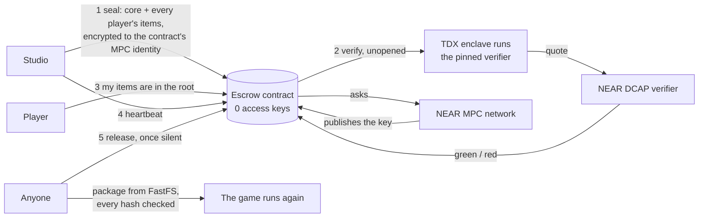

<div align="center">


# Encroe

**The studio shut down. The game didn't.**

### When a studio turns off its servers, its game dies. Encroe hands it to the players instead.
**The game's server is sealed into a NEAR contract that nobody holds a key to. If the studio goes silent, anyone can bring the game back, with everything its players earned.**

[Live site](https://encroe.vercel.app) · [Demo video](https://youtu.be/nnDuYhpsjj0) · [Play Starhaul in 3D](https://encroe.vercel.app/play/starhaul) · [Kill a studio](https://encroe.vercel.app/revive) · [For judges](JUDGES.md) · [For studios](https://encroe.vercel.app/studios) · [For AI agents](#for-ai-agents) · [The thesis](docs/thesis.md)

[](https://github.com/Femtech-web/Encroe/actions/workflows/ci.yml)
[](https://github.com/Femtech-web/Encroe/actions/workflows/studio.yml)
[](https://github.com/Femtech-web/Encroe/actions/workflows/preserve.yml)
[](https://github.com/Femtech-web/Encroe/actions/workflows/live-check.yml)
[](LICENSE)


**NEAR HACKATHON tracks:** Games With Real Economies · Privacy & Private AI · Open Innovation

</div>

## The problem

Online games run on servers only their studio controls. When the studio shuts them down, the game is gone, and so is
everything players earned in it. The Crew went dark in 2024. Anthem became unplayable on 12 January 2026. 1.29
million Europeans signed the Stop Killing Games initiative, and the EU declined to legislate.

A studio can promise to release its servers "one day". Nobody can enforce that promise: by the time it matters, the
studio is gone.

## What Encroe does

Encroe makes that promise enforce itself, with code nobody controls.

1. **Seal.** The studio puts its game server (the code that runs the rules) and every player's items into a NEAR
   contract with no keys. They are encrypted to a key that does not exist yet. NEAR's MPC network can create it, but
   only when the contract asks.
2. **Prove it is real, without opening it.** An Intel TDX enclave opens the sealed build in secret, runs it, and checks
   it serves every player's items exactly. NEAR's own on-chain verifier checks the enclave's hardware proof. The
   escrow's badge turns green, or red for everyone to see.
3. **Keep the heartbeat.** While the studio lives, it signs in regularly, and nothing changes for anyone.
4. **Silence opens it.** If the heartbeat stops for longer than the grace period, anyone can press release. NEAR's MPC
   network publishes the key. Any browser rebuilds the game from NEAR alone, checks every hash, and keeps playing,
   with everyone's items.

5. **The items can leave.** Each player can take what they earned to another chain: NEAR Chain Signatures signs a
   claim with a key nobody holds, and a token contract on Base Sepolia mints exactly the player's sealed items, once.

No lawyer, no escrow agent, no permission. Not even we can stop it.

## The one moment

A studio went silent. An AI agent nobody wrote for Encroe (Claude Code, unmodified, with only this site's MCP server)
found it, checked its escrow had no keys, ran the published code and was verified green, and released it. **4.8
seconds** after the release transaction, NEAR's MPC network published a key that had existed nowhere. **17.5 seconds**
after it, the game was back from NEAR alone: the key's signature, the package's hash, the decryption, the verified
core, all five players' items under NEAR's root, a boot with no imports. Nobody asked anyone's permission
([the run](docs/results/agent-runs/20261114-0843-release-and-revive/README.md), with its full transcript; the silence was ours).

## See it for yourself (no account, five minutes)

| Try | Where | What happens |
|---|---|---|
| **Play a live game** | [/play](https://encroe.vercel.app/play) | Five games in five languages, including **Starhaul in 3D**. Your browser makes a key and signs every move; the game's sealed server core decides it. |
| **Check the vault** | on any game, "Is my stuff in the vault?" | Your browser checks your items against the root NEAR holds, not against our word. |
| **Kill a studio** | [/revive](https://encroe.vercel.app/revive) | A studio here went silent. Press **Release it**: a real NEAR transaction that only its silence allows. |
| **Bring it back** | the same page | Your browser rebuilds the game from NEAR and FastFS alone, with eight checks, then you **play on** with no server at all. |
| **Try to break it** | [/break](https://encroe.vercel.app/break) | Six real attacks on locked escrows: early release, fake heartbeat, fake seal, tampered build, replayed proof, double release. Each is refused on chain. |

**Watch first:** [the demo video](https://youtu.be/nnDuYhpsjj0). Then the guided path is [/judges](https://encroe.vercel.app/judges), and
[JUDGES.md](JUDGES.md) has every claim with its transaction and the commands to check it without our site.

**Check every claim in one command**, from a clone, with Node 20+ and nothing to install, no account and no key:

```bash
node scripts/check-live.mjs
```

It reads NEAR testnet, Base Sepolia and the live site, and prints one line per claim, each `PASS` with what it read,
then `14 of 14 passed.` in about ten seconds: the factory and all 15 escrows keyless and running the published build;
five games in five languages verified green; each served core byte for byte the one its escrow committed, with no
imports; the sealed game on NEAR; a living studio unreleasable; six released by strangers, a visitor, a watcher and
an AI agent; four silent studios waiting; four refusals on chain in the contract's own words; the item token's signer
rederived from NEAR's MPC network; two players' items minted on Base. A
[workflow](.github/workflows/live-check.yml) runs it every six hours.

## Proven on testnet

Every claim below is a real NEAR testnet transaction, written up with all its steps. Nothing is mocked. Where a run
simulates something (a studio going silent, scripted test players), its write-up says so.

| The claim | The evidence |
|---|---|
| A silent studio's game is released by a stranger and comes back in a browser | [kill-827e](docs/results/escrow/kill-827e/README.md); [kill-beaa](docs/results/escrow/kill-beaa/README.md), released by a visitor's click on the site; [ember-3924](docs/results/escrow/ember-3924/README.md), released by a watcher |
| A broken build is caught before it matters | [life-52e4](docs/results/escrow/life-52e4/README.md): red for the broken build, green for the real one |
| NEAR checks the enclave, not us | Every green run: NEAR's DCAP verifier accepted the TDX quote, bound to that exact run |
| A live world stays sealed, with nobody at the keyboard | [embergate](docs/results/escrow/embergate/README.md): the public world, sealed every six hours by a GitHub workflow, now at epoch 4 |
| A studio needs nothing but a browser | [browser-seal](docs/results/escrow/browser-seal/README.md): Neon City's world sealed by the page's own code, verified green |
| Any language works | [Rust, C++, C](docs/results/escrow/cores/README.md) sealed, released and revived; [Zig and Go](docs/results/escrow/engines/README.md) sealed and verified green |
| A released world's items leave the game, signed by a key nobody holds | [items](docs/results/items/README.md): a player's sealed items minted on Base Sepolia through NEAR Chain Signatures; a forged, an inflated, a live-escrow and a repeated claim all refused |
| An escrow can be keyless from its first block | [factory](docs/results/factory/README.md): `encroe.testnet` creates each escrow with no access key, ever |
| Any AI agent can preserve a game | [agent run](docs/results/agent-runs/20261114-0843-release-and-revive/README.md): Claude Code, unmodified, with only the MCP server, released a silent studio's game and brought it back, all 8 checks, in 48 s |
| The rules hold under attack | [/break](https://encroe.vercel.app/break): six attacks, six refusals, in the contract's own words |

## Five games, five languages

The escrow seals compiled bytes, not a framework. Each game below runs on the same interface and is sealed into its own
keyless escrow, made by the factory and verified by the same pinned verifier.

| Game | Language | What you do | Play | Escrow |
|---|---|---|---|---|
| Embergate | Rust | gather, forge relics, trade | [play](https://encroe.vercel.app/play/embergate) | [`encroe-embergate`](https://encroe.vercel.app/escrow/encroe-embergate.testnet) |
| Matchday | C++ | open packs, build a squad, play matches | [play](https://encroe.vercel.app/play/matchday) | [`matchday.encroe`](https://encroe.vercel.app/escrow/matchday.encroe.testnet) |
| Neon City | C | work jobs, buy vehicles and property | [play](https://encroe.vercel.app/play/neon-city) | [`neon-city.encroe`](https://encroe.vercel.app/escrow/neon-city.encroe.testnet) |
| **Starhaul** | **Zig** | **a 3D sector: mine belts, refine alloy, fly contracts** | [play](https://encroe.vercel.app/play/starhaul) | [`starhaul.encroe`](https://encroe.vercel.app/escrow/starhaul.encroe.testnet) |
| Orchard | Go (TinyGo) | tend rows and hives, press cider, win ribbons | [play](https://encroe.vercel.app/play/orchard) | [`orchard.encroe`](https://encroe.vercel.app/escrow/orchard.encroe.testnet) |

Each core is a few kilobytes of WebAssembly with no imports. Rebuilt from source, each one hashes to the `core_sha256`
its escrow committed. [What a game must export](cores/README.md).

## For players

- **Your items are sealed with you.** On any game, "Is my stuff in the vault?" checks your items against the root on
  NEAR, from your browser.
- **If the studio disappears**, open [/revive](https://encroe.vercel.app/revive): your browser takes the sealed game
  from NEAR, opens it with the released key, finds your items, and runs it. [/tools](https://encroe.vercel.app/tools#items)
  finds your items in any released game.

## For studios

1. **Create your escrow** at [/studios](https://encroe.vercel.app/studios), from your NEAR wallet: one call to the
   factory gives you `<name>.encroe.testnet`, keyless from birth.
2. **Compile your server core** with your own toolchain (Rust, C++, C, Zig, Go, or anything that targets wasm32 with no
   imports) and **check it** at [/tools](https://encroe.vercel.app/tools#core) before you seal it.
3. **Seal your world** at [/studios/seal](https://encroe.vercel.app/studios/seal), from the browser: three wallet
   signatures (the key row, the commitment, the verification). Or let
   [`scripts/studio/bot.sh seal`](scripts/studio/bot.sh) do it on a schedule.
4. **Keep your heartbeat**: [`studio.yml`](.github/workflows/studio.yml) sends it and re-seals your world every six
   hours, or send it yourself from your escrow's page. Stop it, and after your grace period the game is your players'.

## For AI agents

The site is an MCP server. An agent can list escrows, inspect one, release a silent studio's game, bring a released
game back with every check, and find a player's items in it.

```bash
claude mcp add --transport http encroe https://encroe.vercel.app/api/mcp
```

Off-the-shelf Claude Code did exactly that with nothing else: it found a silent studio, inspected its escrow, released
it and brought the game back with all 8 checks, in 48 seconds ([the run](docs/results/agent-runs/20261114-0843-release-and-revive/README.md),
with its task, configuration and full transcript).

Our own [preservation agent](https://encroe.vercel.app/agent) uses the same tools every 30 minutes
([`preserve.yml`](.github/workflows/preserve.yml)). It releases any watched escrow whose studio went silent, brings
every released game back, and keeps a public log.

## Under the hood



1. **Seal.** The studio seals its server core and a snapshot of every player's items into one package, encrypted to a
   key that NEAR's MPC network derives for the contract's identity (confidential key derivation, used as
   identity-based encryption). Before the release, nobody holds that key. The package goes on NEAR itself, through
   FastFS.
2. **Verify it, unopened.** OutLayer's TDX enclave decrypts the package with a key row only the pinned verifier, called
   by this escrow, can read. It runs the core, checks 16 sampled players are served byte for byte, and checks seeded
   trades conserve every item. The contract accepts the run only after NEAR's DCAP verifier accepts the enclave's
   quote, bound to that run's input and output.
3. **Check your own items.** Each player's items are a salted Merkle leaf. A player proves theirs is under the
   committed root without revealing anyone else's.
4. **The heartbeat.** If the studio is silent past its grace period, or declares end of life, **anyone** can call
   `release`. The contract has no keys: nobody can stop it or move it early.
5. **The game comes back.** NEAR's MPC network publishes the key. Anyone checks it is the network's signature for this
   contract, decrypts the package, checks it is exactly the verified build, and runs it, in a browser, in seconds.

## What NEAR makes possible

| NEAR | Used for |
|---|---|
| **Chain Signatures** | A keyless contract signs a player's item claim for Base Sepolia, with a key NEAR's MPC network derives for it alone |
| **MPC network, confidential key derivation** | The escrow's key: derived for the contract's identity, published only when the contract asks |
| **DCAP verifier** (`tee-verifier-2026-07-22.testnet`) | The contract checks Intel TDX quotes on chain, so it trusts the hardware, not an operator |
| **Contracts with no access keys** | The release rule an escrow is born with is the one it dies with |
| **A factory** (`encroe.testnet`) | Each studio's escrow is created as a subaccount with no access key at all, running the published build |
| **FastFS** | The sealed package lives on NEAR: bringing a game back needs no studio server |
| **OutLayer** (TDX) | Runs the pinned verifier on the sealed build; its operators are not trusted |
| **Promises and callbacks** | One release asks the MPC network and records its answer; one verify asks OutLayer and records its verdict |

## Checked and attacked

- **[Properties](docs/properties.md):** twenty guarantees, each with the test that holds it and the live run that
  shows it. **[Threat model](docs/threat-model.md):** who could cheat, how, and what stops them.
  **[What you trust](docs/trust.md):** what you rely on in each part, and how to check it yourself.
  **[Crypto spec](docs/crypto-spec.md):** every byte committed, encrypted, signed or checked, and the test that holds
  its two implementations together.
- **[27 attacks, and what each costs](docs/attacks.md):** every way to cheat we tried, what stopped it, and where the
  refusal is on record; 12 of them run live on testnet and refused. [/break](https://encroe.vercel.app/break) sends six
  of them to locked escrows on demand, and a test checks every refusal it expects is in the contract's source.
- **Tested:** 31 Rust tests (CKD vectors, IBE, the verifier, the escrow, the factory, the item handover, the game
  core), 5 Solidity tests (the item token) and 204 site tests: the browser's crypto against real released epochs,
  browser sealing against the Rust sealer, all five cores held to the enclave's checks, the RPC fallback, and 110
  property cases over generated worlds (every path reaches the root and no other leaf's does; any change to an item,
  salt, epoch or game changes it; item claims prove only their own leaf). CI runs them with a secret scan on every
  push.
- **Built to stay up:** the site reads NEAR through three public RPCs and falls back when one is rate-limited or down;
  pages stream, so they appear at once while live numbers load.

## Deployment (NEAR testnet)

| Account | What it is |
|---|---|
| [`encroe.testnet`](docs/results/factory/README.md) | The factory and directory: locked; every escrow it creates is keyless from birth |
| `matchday`, `neon-city`, `starhaul`, `orchard` `.encroe.testnet` | The public worlds' escrows, made by the factory |
| [`encroe-embergate.testnet`](https://encroe.vercel.app/escrow/encroe-embergate.testnet) | Embergate's public world: 14-day grace, sealed every six hours |
| `encroe-life-52e4`, `-ember-3924`, `-kill-827e`, `-kill-beaa`, `-matchday-5d60`, `-neon-city-19f9` | Recorded runs ([`docs/results/escrow`](docs/results/escrow)) |
| `encroe-kill-19d2`, `-kill-0c87`, `-kill-9400`, `-kill-5781` | Silent studios, sealed and verified green, left for visitors to release (`-kill-5609` was released by [an AI agent](docs/results/agent-runs/README.md), `-kill-da6a` by a visitor) |
| `encore-pub-6b4dad.testnet`, `encore-stranger-6b4dad.testnet` | The studio, and an unrelated account that verifies, proves and releases |
| [`encroe-items-ba9e16.testnet`](docs/results/items/README.md) | The item handover: keyless; its MPC-derived EVM signer is `0x30e6…AbbCd` |
| [`EncroeItems` on Base Sepolia](https://sepolia.basescan.org/address/0x94365D73B3C539680622E681aEAcefeC01c8a2e1) | `0x94365D73…a2e1`: mints only claims that signer signed |
| `handover.encroe.testnet` | A world released to show the handover |
| `encroe-relay-3778.testnet` | The site's throwaway relayer: gas for releases, attacks and FastFS uploads sent from the site |
| `v1.signer-prod.testnet`, `tee-verifier-2026-07-22.testnet`, `outlayer.testnet` | NEAR's MPC network, NEAR's DCAP verifier, OutLayer |

| Build | sha256 |
|---|---|
| The escrow contract | `08d9174fedb6374971b076591d915423d2fab6bc7f5bb056be308178b3901fbf` |
| The item handover contract | `fc69492e95e52bf27cd09bf0b9344b6ea9c9fc27a92ad998ea95a46bae088863` |
| The pinned verifier (wasm32-wasip2) | `9c0eb2e7a47e83c8feaa3d54780bf8848eb5ec13659d4e925b010e4faf756aad` |
| Embergate (Rust) | `49ff0c57f10f24b9091eae3bd218b28a642d581f698871f6b3c65b7effa9cb62` |
| Matchday (C++) | `f149751774f754b956636225c79d294494e1b5dc2c523867eeb2d5b3f96dba4a` |
| Neon City (C) | `3f4a1e626aa6fc2e819aaaf5e3ee718e0e6307de87d47c895a93addb336bb3d2` |
| Starhaul (Zig) | `f8a50a172e7da0c34c64c08443194d9e737da720749d31b775ada99ad64c463e` |
| Orchard (Go) | `91665f535afb63e4f9c86a5cd33eefde9eac9550e416a679457ac73068cd0e0f` |

## Run it from source

Requirements: Rust with the `wasm32-unknown-unknown` and `wasm32-wasip2` targets, `wasmtime`, Foundry (`forge`),
Node.js 20+ and Python 3. `npm install` at the root provides `near-cli-rs` and `cargo-near`.

```bash
npm install
make test                        # 31 Rust and 5 Solidity tests (Foundry), plus native-vs-wasm determinism
scripts/build/cores.sh           # the C++, C, Zig and Go cores (Zig, TinyGo and Binaryen in .tools/, sha256-checked)
cd web && npm ci && npm test     # 204 site tests, 110 of them property cases
npm run dev                      # http://localhost:3000; the worlds are kept in web/.data
make reproduce-e1                # a third party's check of a release, from public data only
```

On Vercel the site needs Upstash Redis for the worlds (`UPSTASH_REDIS_REST_URL`/`_TOKEN`), `ENCROE_STUDIO_TOKEN` for
the studio's bot, and `ENCROE_RELAYER_ACCOUNT`/`_KEY`, a throwaway testnet account that pays gas for what the site
sends. Keys and secrets (`.secrets/`, `.env`, `web/.env.local`, `~/.near-credentials`) are never committed; a
gitleaks hook and CI refuse them. Sealed packages and commitments in `docs/results/` are public by design.

## Limits

1. **Testnet only.** No mainnet transaction has been sent.
2. **Simulated silence.** In every recorded release, we stopped the studio's heartbeat ourselves.
3. **64 players per world.** The snapshot and the enclave's checks are sized for it.
4. **Our games, not a studio's.** All five games are ours. Any game whose server state fits
   [the interface](cores/README.md) can be sealed the same way.
5. **After a release, each player hosts their own copy** in the browser. Shared hosting is designed, not built.
6. **The verifier samples** 16 players and seeded trades per run: a strong check, not a proof of every path.

## Roadmap

**Done since v0.1.0:** sealing from the browser, Zig and Go cores, Starhaul in 3D, items handed over on Base Sepolia
through Chain Signatures, RPC fallback and streamed pages.

**Next:**

- **Community hosts, paid only while they provably serve.** Hosts run a released core in an enclave; a pool pays them
  only for time NEAR's DCAP verifier confirms they served it.
- **Items on more chains.** The handover runs on Base Sepolia today; the same MPC key signs for Ethereum, and an
  Ed25519 domain would reach Solana.
- **Unity's C#**, through NativeAOT to WebAssembly, on the same interface.
- **Mainnet, and bigger worlds**, with paged snapshots under one root.

## Repository

| Path | What |
|---|---|
| [`contracts/encroe-escrow`](contracts/encroe-escrow) | The escrow: commit, verify and `prove_run`, heartbeat, end of life, `release`, `status` |
| [`contracts/encroe-items`](contracts/encroe-items), [`contracts/evm`](contracts/evm) | The item handover: the keyless NEAR contract that checks a claim and asks the MPC network to sign it; the ERC-1155 that mints it |
| [`contracts/encroe-factory`](contracts/encroe-factory) | The factory and directory: `create_escrow` (keyless from birth, the one escrow build compiled in), `list` |
| [`crates/encore-crypto`](crates/encore-crypto) | NEAR CKD compatibility, IBE key sealing, the AES-GCM package, salted leaves and the Merkle root |
| [`crates/encore-verifier`](crates/encore-verifier) | The verifier the enclave runs (pinned by hash `9c0eb2e7…`), also native for preflight |
| [`crates/embergate-core`](crates/embergate-core), [`cores/`](cores) | The five game servers; [what a core must export](cores/README.md) |
| [`crates/encore-cli`](crates/encore-cli), [`crates/encore-attest`](crates/encore-attest) | `encore`: seal, open, preflight, FastFS payloads; an independent TDX quote check |
| [`web/`](web) | The site: the games (and Starhaul's 3D sector), the vault check, the directory, browser sealing, `/revive`, `/break`, the agent, the MCP server |
| [`scripts/`](scripts) | The studio's bot, each escrow's life step by step (`testnet/escrow.sh`), the factory, the core builds |
| [`.github/workflows`](.github/workflows) | `ci.yml`; `studio.yml` (heartbeats and seals, every six hours); `preserve.yml` (the agent, every 30 minutes); `prove.yml` (NEAR's quote check for browser seals) |
| [`docs/`](docs) | [The thesis](docs/thesis.md), every run's evidence in [`docs/results`](docs/results), the trust, threat and properties write-ups |

## NEAR Hackathon

- **Tracks entered:** Games With Real Economies (`games`, primary), Privacy & Private AI (`privacy`) and Open
  Innovation (`open`). `games`: a game's economy (every player's items, the rules that move them) that outlives its
  studio with no dev patch, items that leave the game as tokens players own, and players who never touch a wallet or
  see the chain. `privacy`: confidential computation (a sealed build verified inside an Intel TDX enclave without
  anyone opening it, attested on NEAR) and players' items encrypted and salted until the release. `open`: game
  preservation fits no other category: a key nobody holds, released by a contract on silence.
- **NEAR, for what only it does here:** confidential key derivation used as identity-based encryption (a key that
  exists nowhere until the contract asks), the DCAP verifier (the enclave is trusted only after NEAR checks its
  quote), Chain Signatures (a keyless contract signs item claims for Base), contracts with no access keys and a
  factory that never gives one, FastFS (the sealed game lives on NEAR), and NEAR Connect (studios seal from the
  browser).
- **Built during the hackathon:** every commit is from 2026-11-13 on, and the go/no-go experiments it grew from
  ([GO_NO_GO.md](GO_NO_GO.md)) from 2026-11-11; the hackathon ran 2026-11-01 to 11-14.
- **AI-assisted:** written with Claude Code. The design, the threat model and every decision on scope were reviewed
  by the author.
- **Libraries and tools:** near-sdk 5.17, arkworks (BLS12-381), aes-gcm, sha2/sha3 and hex (Rust); Solidity 0.8.28
  with Foundry and forge-std; Next.js 16, React 19, Tailwind CSS 4, three.js 0.187, @noble/curves, @noble/hashes and
  @noble/ciphers, @hot-labs/near-connect, tested with Vitest; near-cli-rs, cargo-near, OutLayer, Zig 0.17, TinyGo
  0.44 and Binaryen for the cores.
- **Business model (proposed, not built):** studios pay a flat fee per escrow created through the factory and the
  enclave's cost per verification (cents); players and fans could fund a hosting pool for a revived game; a small
  share of hosting payments would fund the network of agents that watch every escrow. Nothing is charged on testnet.
- **Sustainability:** nothing depends on us staying around. Escrows are keyless and their rules permanent, sealed
  games live on NEAR (FastFS), and the revive code runs from any copy of this repository; if our site, relayer and
  agent all vanished, any player could still release a silent studio's game and play it. What it costs to keep a game
  insured is small and paid by the studio: one escrow (5 NEAR of storage, once), a heartbeat transaction, and an
  enclave run per sealed epoch (about 0.0013 NEAR measured; the 0.14 NEAR deposit is mostly refunded).
- **The author's other entry:** [Klear](https://github.com/Femtech-web/Klear) ([live](https://klear-near.vercel.app)):
  *let AI trade your money, without giving it the keys.* An investor's rules live in a keyless NEAR contract that is
  the only signer of their accounts on Hyperliquid and Base, through Chain Signatures; if the AI fails, anyone can
  bring the money home and is paid only once it arrives. The two projects are independent and were built side by
  side: Klear reuses this repository's borsh types for NEAR's DCAP verifier, and Encroe's item token on Base Sepolia
  was deployed and relayed from Klear's testnet relayer (disclosed in [the record](docs/results/items/README.md)).
- **The name:** this project was called Encore until 2026-11-13. Deployed accounts, crates and recorded results keep
  that name: renaming them would change their hashes and break the on-chain records.

## License

MIT, see [LICENSE](LICENSE).
