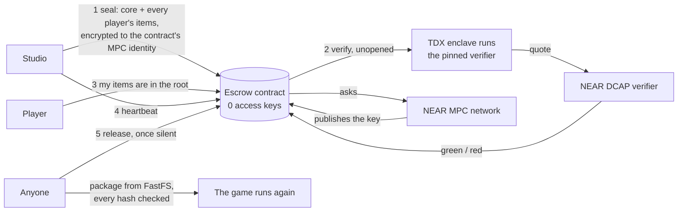

# Encroe

**The studio shut down. The game didn't.**

Every online game has a kill switch, and only the studio holds it. Encroe takes it away: a studio seals its game
server into a NEAR contract that has no keys. While the studio lives, anyone can check the sealed build is real,
without opening it. If the studio goes silent, anyone can release it, and the game goes to its players with
everything they earned. No lawyer, no escrow agent, no permission, no key anyone holds.

**Live: [encroe.vercel.app](https://encroe.vercel.app)**, on NEAR testnet, with a game to play, a studio to kill
and a world to bring back. [For judges](JUDGES.md) · [the thesis](docs/thesis.md) · [what you trust](docs/trust.md)
· [threat model](docs/threat-model.md) · [properties](docs/properties.md) · [evidence](docs/results/escrow)

## Try it now, no account

- **Kill a studio** ([encroe.vercel.app](https://encroe.vercel.app), "Kill a studio"): a studio sealed its world, got it
  verified, and went silent. Press **Release it**: a real NEAR transaction that only its silence allows. Then watch
  your browser bring the game back from NEAR alone and play on.
- **Try to break it** ([/break](https://encroe.vercel.app/break)): six real attacks on live, locked escrows, each
  refused on chain in the contract's own words.
- **Check a game core** ([/tools](https://encroe.vercel.app/tools)): drop any compiled core and your browser runs
  what the enclave will.

## The one moment

A studio disappears. Its game's escrow, a NEAR contract nobody holds a key to, notices the silence. A stranger asks
for the release; NEAR's MPC network publishes the key that existed nowhere until then. A player's browser takes the
sealed package from NEAR, checks it is exactly the build an Intel TDX enclave verified while the studio lived, opens
it, finds their key among the players, and the game runs again, with their Phoenix still in their satchel. No one
asked anyone's permission, and no one could have stopped it.

## For judges

1. **Play** Embergate at [encroe.vercel.app/play](https://encroe.vercel.app/play), then ask **"Is my stuff in the
   vault?"**: your browser checks your items against the root it reads from NEAR.
2. **Kill a studio** ([home page](https://encroe.vercel.app)): press **Release it** on a studio that went silent. A
   real NEAR transaction; the contract decides.
3. **Bring it back** ([/revive](https://encroe.vercel.app/revive)): watch your browser rebuild the game from NEAR
   and FastFS alone, eight checks, then **Play on** with no server at all.
4. **Try to break it** ([/break](https://encroe.vercel.app/break)): six real attacks on live, locked escrows, each
   refused on chain with its transaction.

The guided path is on the site at **[/judges](https://encroe.vercel.app/judges)**; the commands to check it without
our site, and every claim with its transaction, are in **[JUDGES.md](JUDGES.md)**.

## The product

| Page | For | What it does |
|---|---|---|
| [`/play`](https://encroe.vercel.app/play) | players | **Pick a game and play it live**: Embergate (Rust), Matchday (C++), Neon City (C), every move signed by your browser's key and decided by the game's sealed core on the server; **"Is my stuff in the vault?"**: your proof checked against NEAR's root |
| [`/studios`](https://encroe.vercel.app/studios) | studios | **Create your game's escrow from your wallet**: one call to the factory, `<name>.encroe.testnet`, keyless from birth |
| [`/tools`](https://encroe.vercel.app/tools) | studios, players | **Check your core** before you seal it (the enclave's checks, in your browser), check your players file, build recipes, **find your items** in a released game |
| [`/escrows`](https://encroe.vercel.app/escrows) | everyone | **The directory**: every escrow, read live from NEAR; each one's page shows its keys, code, sealed epoch, runs and what anyone may do, and a **studio console** (heartbeat, end of life) for its studio's wallet |
| [`/revive`](https://encroe.vercel.app/revive) | players | **Bring a released game back** in the browser, then play on: Embergate, Matchday (C++) and Neon City (C) |
| [`/proof`](https://encroe.vercel.app/proof) | judges, skeptics | **The evidence, apart from the product**: every recorded run, the attacks, the three languages, the go/no-go experiments |
| [`/break`](https://encroe.vercel.app/break) | skeptics | **Try to break it**: early release, fake heartbeat, fake seal, tampered build, replayed quote, double release, all refused live |
| [`/agent`](https://encroe.vercel.app/agent) | everyone | **The preservation agent**: releases silent studios' games and brings them back on its own, every 30 minutes; its log |
| [`/api/mcp`](https://encroe.vercel.app/api/mcp) | AI agents | **An MCP server**: `claude mcp add --transport http encroe https://encroe.vercel.app/api/mcp` |

## The problem

When a studio turns off its servers, players lose a game they paid for and everything they earned in it. The Crew's
servers went dark in 2024; Anthem became unplayable on 12 January 2026. 1.29 million Europeans signed the Stop
Killing Games initiative, and the EU declined to legislate. A studio's promise of an "end-of-life plan" cannot be
enforced: by the time it matters, the studio is gone.

## How it works



1. **Seal.** The studio seals its server core and a snapshot of every player's items, encrypted to a key derived for
   the contract's identity by NEAR's MPC network (CKD used as identity-based encryption). Before the release,
   nobody holds that key: not the studio, not us. The sealed package goes on NEAR itself, through FastFS.
2. **Verify it, unopened.** An Intel TDX enclave (OutLayer) decrypts the sealed build with a key row only the pinned
   verifier, run for this escrow, can read. It runs the core, checks it serves every sampled player's items exactly
   and conserves items across seeded trades. The contract accepts the run only after **NEAR's own DCAP verifier**
   checks the enclave's quote, bound to that exact run. A broken build turns the badge red for everyone.
3. **Check your own items.** Each player's items sit in a salted Merkle leaf; a player proves theirs is under the
   committed root without revealing anyone else's.
4. **The heartbeat.** The studio keeps signing in. If it goes silent past its grace period, or declares end of life,
   **anyone** can call `release`. The contract has no keys: nobody can stop it or move it early.
5. **The game comes back.** NEAR's MPC network publishes the key. Anyone decrypts the package, checks it is exactly
   the build the enclave verified, and runs the server, with everyone's items intact. In a browser, in seconds.

## Live on testnet

Every escrow is locked (0 access keys) before anything is sealed. Each run is written up with all its transactions.

| Escrow | What it shows |
|---|---|
| [`encroe-life-52e4`](docs/results/escrow/life-52e4/README.md) | The first full life: a broken build caught red, the real one green through NEAR's DCAP verifier, a replayed quote and an early release refused, the studio's silence, a stranger's release, the package opened |
| [`encroe-ember-3924`](docs/results/escrow/ember-3924/README.md) | A world played through the game, sealed by the studio's bot, verified green; a player checks their items from the browser |
| [`encroe-kill-827e`](docs/results/escrow/kill-827e/README.md) | A silent studio: released by a stranger, the game brought back in a browser from public data, played on |
| [`encroe-kill-beaa`](docs/results/escrow/kill-beaa/README.md) | The same, from the site: a visitor's click released it, the page brought it back |
| [`encroe-matchday-5d60`, `encroe-neon-city-19f9`](docs/results/escrow/cores/README.md) | C++ and C game servers: sealed, verified green by the enclave, released, revived and played on in a browser |
| [`encroe-embergate`](docs/results/escrow/embergate/README.md) | **The site's public world**, sealed by the studio's bot with a 14-day grace: alive, so it holds |
| [`encroe.testnet`, `matchday.encroe.testnet`, `neon-city.encroe.testnet`](docs/results/factory/README.md) | **The factory**, locked, and the first escrows it made: keyless from birth, the published build, listed; Matchday's sealed and verified green |

### Any engine, any language

The escrow seals compiled bytes, not a framework. Three games, three languages, one pinned verifier: each core is
sealed into its own locked escrow, verified by the enclave, released and revived in a browser
([how a game qualifies](cores/README.md)).

| Game | Language | Genre | Core |
|---|---|---|---|
| Embergate | Rust | crafting world | [`crates/embergate-core`](crates/embergate-core/src/lib.rs) |
| Matchday | C++20 | football card club (the Ultimate Team genre) | [`cores/matchday`](cores/matchday/matchday.cpp) |
| Neon City | C11 | open-world city economy (the GTA Online genre) | [`cores/neon-city`](cores/neon-city/neon_city.c) |

The mechanism's go/no-go experiments (the MPC release, the verifier's secret gating, the TDX quote, NEAR's DCAP
verifier) are in [GO_NO_GO.md](GO_NO_GO.md).

## For studios

1. **Create your escrow** at [/studios](https://encroe.vercel.app/studios), from your NEAR wallet: one call to the
   factory, `<name>.encroe.testnet`, keyless from birth.
2. **Compile your server core** with your own toolchain (Rust, C++, C, anything that targets wasm32 with no imports)
   and **check it** at [/tools](https://encroe.vercel.app/tools#core) before you seal it. [The interface](cores/README.md).
3. **Seal your live world**: `scripts/studio/bot.sh seal` exports your players, seals them with your core to NEAR's
   MPC key, runs the pinned verifier locally, stores the epoch's key row, commits, hands every player their proof,
   and has the enclave verify it.
4. **Keep your heartbeat**: [`.github/workflows/studio.yml`](.github/workflows/studio.yml) sends it and re-seals your
   world every six hours, or send it yourself from your escrow's page with your wallet (the studio console, which
   also declares end of life with a notice period). Stop it, and after your grace period the game is your players'.

## For AI agents

The site is an MCP server: list escrows, inspect one, release a silent studio's game, bring a released game back with
every check, find a player's items in it, read the agent's log.

```bash
claude mcp add --transport http encroe https://encroe.vercel.app/api/mcp
```

Our own [preservation agent](https://encroe.vercel.app/agent) uses the same engine every 30 minutes
([`preserve.yml`](.github/workflows/preserve.yml)): it releases any watched escrow whose studio went silent and brings
every released game back, keeping a public log.

## Checked and attacked

- **[Properties](docs/properties.md)**: fifteen guarantees, each with the test that holds it and the live run that
  shows it. **[Threat model](docs/threat-model.md)**: who could cheat, how, and what stops them.
  **[Trust](docs/trust.md)**: what you trust in each part, and how to check it yourself, including what the escrow
  cannot know.
- **Attacked live**: [/break](https://encroe.vercel.app/break) sends six attacks to locked escrows; a test checks every
  refusal it expects is written in the contract's source.
- **Tested**: 27 Rust tests (CKD vectors, IBE, the verifier, the escrow, the factory, the game core) and 61 site
  tests, including the browser's crypto against real released epochs and all three cores held to the enclave's
  checks. CI runs them, with a secret scan, on every push.

## NEAR, and why only NEAR

| | Used for |
|---|---|
| **MPC network, confidential key derivation** | The escrow's key: derived for the contract's identity, released publicly only when the contract asks |
| **DCAP verifier** (`tee-verifier-2026-07-22.testnet`) | The contract checks Intel TDX quotes on chain, so it trusts the hardware, not an operator |
| **A contract with no access keys** | The release condition it was born with is the one it dies with |
| **FastFS** | The sealed package lives on NEAR: bringing a game back needs no studio server |
| **OutLayer** (TDX) | Runs the pinned verifier on the sealed build; its operator keys are not trusted |
| **Keyless from birth** (`encroe.testnet`) | The factory creates each studio's escrow as a subaccount with no access key at all, running the escrow build compiled into it |
| **Promises and callbacks** | One release asks the MPC network and records its answer; one verify asks OutLayer and records its verdict |

## Deployment (NEAR testnet)

| Account | What it is |
|---|---|
| [`encroe-embergate.testnet`](https://encroe.vercel.app/escrow/encroe-embergate.testnet) | The site's public world: 14-day grace, sealed every six hours by the studio workflow |
| [`encroe.testnet`](docs/results/factory/README.md) | The factory and directory: locked; every escrow it creates is keyless from birth |
| `matchday.encroe.testnet`, `neon-city.encroe.testnet` | The public Matchday and Neon City worlds' escrows, made by the factory |
| `encroe-life-52e4`, `-ember-3924`, `-kill-827e`, `-kill-beaa`, `-matchday-5d60`, `-neon-city-19f9` | Recorded runs ([`docs/results/escrow`](docs/results/escrow)) |
| `encroe-kill-5609`, `-kill-da6a`, `-kill-19d2` | Silent studios, left for visitors to release |
| `encore-pub-6b4dad.testnet` | The studio (owner of our escrows) |
| `encore-stranger-6b4dad.testnet` | An unrelated account: verification, proofs, releases in the recorded runs |
| `encroe-relay-3778.testnet` | The site's throwaway relayer: gas for releases and attacks sent from the site |
| `v1.signer-prod.testnet` | NEAR's MPC network (domain 2: confidential key derivation) |
| `tee-verifier-2026-07-22.testnet` | NEAR's DCAP verifier |
| `outlayer.testnet`, `worker.outlayer.testnet` | OutLayer (the enclave) and its registry of approved TDX images |

| Build | sha256 |
|---|---|
| The escrow contract | `08d9174fedb6374971b076591d915423d2fab6bc7f5bb056be308178b3901fbf` |
| The pinned verifier (wasm32-wasip2) | `9c0eb2e7a47e83c8feaa3d54780bf8848eb5ec13659d4e925b010e4faf756aad` |
| Embergate's core (Rust) | `49ff0c57f10f24b9091eae3bd218b28a642d581f698871f6b3c65b7effa9cb62` |
| Matchday's core (C++) | `f149751774f754b956636225c79d294494e1b5dc2c523867eeb2d5b3f96dba4a` |
| Neon City's core (C) | `3f4a1e626aa6fc2e819aaaf5e3ee718e0e6307de87d47c895a93addb336bb3d2` |

## What is in the repository

| Path | What |
|---|---|
| [`contracts/encroe-escrow`](contracts/encroe-escrow) | The escrow: commit an epoch, verify and `prove_run` (NEAR DCAP), heartbeat, end of life, `release`, `status` |
| [`contracts/encroe-factory`](contracts/encroe-factory) | The factory and directory: `create_escrow` for any studio (keyless from birth, the one escrow build compiled in), `list` |
| [`crates/encore-crypto`](crates/encore-crypto) | NEAR CKD compatibility, IBE key sealing, the AES-GCM package, salted player leaves and Merkle root |
| [`crates/encore-verifier`](crates/encore-verifier) | The verifier the enclave runs (wasm32-wasip2, pinned by hash `9c0eb2e7…`), also native for preflight |
| [`crates/embergate-core`](crates/embergate-core) | Embergate's server core: every rule of the game, the bytes that are sealed (wasm, no imports) |
| [`cores/`](cores) | Matchday (C++) and Neon City (C), the same interface in other languages; [what a core must export](cores/README.md) |
| [`crates/encore-cli`](crates/encore-cli), [`crates/encore-attest`](crates/encore-attest) | `encore`: seal, open, preflight, FastFS payloads, inclusion checks; an independent TDX quote check |
| [`web/`](web) | The site: the game, the vault check, the directory and escrow pages, the studios' wallet flow, `/revive`, `/break`, the agent, the MCP server |
| [`scripts/studio/bot.sh`](scripts/studio/bot.sh) | The studio's side: export the world, seal, preflight, commit, verify, prove, hand players their proofs; the kill-a-studio pool |
| [`scripts/testnet/escrow.sh`](scripts/testnet/escrow.sh) | One escrow's life, step by step, each step recorded in `docs/results/escrow/<name>/` |
| [`scripts/testnet/factory.sh`](scripts/testnet/factory.sh) | Deploy and lock the factory; create a studio's escrow through it |
| [`.github/workflows`](.github/workflows) | `studio.yml`: the public world's heartbeat and seal, every six hours; `preserve.yml`: the agent's sweep, every 30 minutes |
| [`docs/`](docs) | [The thesis](docs/thesis.md), every run's evidence, the earlier experiments |

## Build and test

Requirements: Rust with the `wasm32-unknown-unknown` and `wasm32-wasip2` targets, `wasmtime`, Node.js 20+ and
Python 3. `npm install` at the root provides `near-cli-rs` and `cargo-near`.

```bash
npm install
make test                        # Rust: 27 tests (CKD vectors, IBE, verifier, the escrow's lifecycle, the factory,
                                 # the game core)
                                 # plus native-vs-wasm determinism of the verifier
scripts/build/cores.sh           # the C++ and C cores, with Zig 0.17 (no system toolchain needed)
cd web && npm ci && npm test     # the site: the browser code against real released data, and all three cores
                                 # held to the enclave's checks
npm run dev                      # http://localhost:3000; the world is kept in web/.data
make reproduce-e1                # a third party's check of a release, from public data only
```

The site needs, on Vercel: Upstash Redis for the world (`UPSTASH_REDIS_REST_URL`/`_TOKEN`, or Vercel's
`KV_REST_API_URL`/`_TOKEN`), `ENCROE_STUDIO_TOKEN` for the studio's bot, and `ENCROE_RELAYER_ACCOUNT`/`_KEY`, a
throwaway testnet account that pays the gas of releases sent from the site.

Secrets (`.secrets/`, `.env`, `web/.env.local`) and keys (`~/.near-credentials`) are never committed; a gitleaks
pre-commit hook refuses them. The sealed packages and commitments in `docs/results/` are public by design. A live
world's salts are not: each player gets only their own.

## Limits

1. **Testnet.** No mainnet transaction has been sent.
2. **Simulated silence.** In the recorded releases we stop the studio's heartbeat ourselves.
3. **64 players per world.** The snapshot and the enclave's checks are sized for it.
4. **Our games, not theirs.** Embergate, Matchday and Neon City are ours, in Rust, C++ and C; any game whose server
   state fits [the interface](cores/README.md) can be sealed the same way. The site hosts Embergate's live world;
   all three can be revived and played in the browser after a release.
5. **After a release, each player hosts their own copy** in the browser. Shared hosting, paid on proof, is not built.
6. **The verifier samples** 16 players and seeded trades per run; it is a strong check, not a proof of every path.

## Next, and not built yet

- **Community hosts, paid only while they provably serve.** Hosts run a released core in an enclave; the escrow
  pays them from a pool only for the time NEAR's DCAP verifier confirms they served it.
- **Items handed over on other chains.** With NEAR Chain Signatures, the escrow itself signs a transfer on
  Ethereum or Solana, so a sealed item becomes a token its owner holds anywhere.
- **Every engine.** Unity's C# (NativeAOT to WebAssembly), Go (TinyGo) and Zig, on the same interface.
- **Mainnet, and bigger worlds**, with paged snapshots under one root.

## NEAR Hackathon

- **The author's other entry:** [Klear](https://github.com/Femtech-web/Klear), rules for AI traders enforced on
  NEAR. The two are independent; Klear's `klear-tee` contract reuses this repository's borsh types for NEAR's DCAP
  verifier (`contracts/encore-t1/src/tee.rs`).
- **The name:** this project was called Encore until 2026-11-13. Deployed accounts, crates, contracts and recorded
  results keep that name: renaming them would change their hashes and break the on-chain records.

## License

MIT, see [LICENSE](LICENSE).
