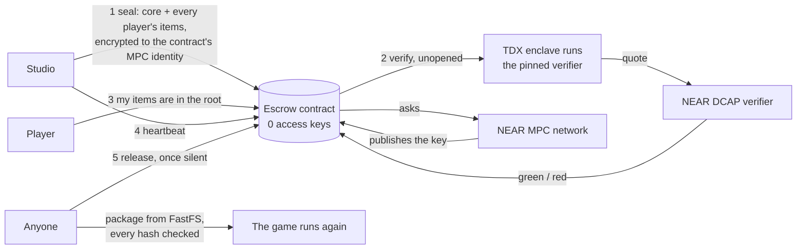

# Encroe

**The studio shut down. The game didn't.**

Every online game has a kill switch, and only the studio holds it. Encroe takes it away: a studio seals its game
server into a NEAR contract that has no keys. While the studio lives, anyone can check the sealed build is real,
without opening it. If the studio goes silent, anyone can release it, and the game goes to its players with
everything they earned. No lawyer, no escrow agent, no permission, no key anyone holds.

Live on NEAR testnet, with a game to play, a studio to kill and a world to bring back:
**[for judges](JUDGES.md)** · [the thesis](docs/thesis.md) · [evidence](docs/results/escrow)

## For judges

1. **Play** Embergate on the site (`/play`), then ask **"Is my stuff in the vault?"**: your browser checks your items
   against the root it reads from NEAR.
2. **Kill a studio** (home page): press **Release it** on a studio that went silent. A real NEAR transaction; the
   contract decides.
3. **Bring it back** (`/revive`): watch your browser rebuild the game from NEAR and FastFS alone, eight checks, then
   **Play on** with no server at all.

The full path, the commands to check it without our site, and every claim with its transaction:
**[JUDGES.md](JUDGES.md)**.

## The problem

When a studio turns off its servers, players lose a game they paid for and everything they earned in it. The Crew's
servers went dark in 2024; Anthem became unplayable on 12 January 2026. 1.29 million Europeans signed the Stop
Killing Games initiative, and the EU declined to legislate. A studio's promise of an "end-of-life plan" cannot be
enforced: by the time it matters, the studio is gone.

## How it works



1. **Seal.** The studio seals its server core and a snapshot of every player's items, encrypted to a key derived for
   the contract's identity by NEAR's MPC network (CKD used as identity-based encryption). Before the release,
   nobody holds that key: not the studio, not us. The sealed package goes on NEAR itself, through FastFS.
2. **Verify it, unopened.** An Intel TDX enclave (OutLayer) decrypts the sealed build with a key row only the pinned
   verifier, run for this escrow, can read. It runs the core, checks it serves every sampled player's items exactly
   and conserves items across seeded trades. The contract accepts the run only after **NEAR's own DCAP verifier**
   checks the enclave's quote, bound to that exact run. A broken build turns the badge red for everyone.
3. **Check your own items.** Each player's items sit in a salted Merkle leaf; a player proves theirs is under the
   committed root without revealing anyone else's.
4. **The heartbeat.** The studio keeps signing in. If it goes silent past its grace period, or declares end of life,
   **anyone** can call `release`. The contract has no keys: nobody can stop it or move it early.
5. **The game comes back.** NEAR's MPC network publishes the key. Anyone decrypts the package, checks it is exactly
   the build the enclave verified, and runs the server, with everyone's items intact. In a browser, in seconds.

## Live on testnet

Every escrow is locked (0 access keys) before anything is sealed. Each run is written up with all its transactions.

| Escrow | What it shows |
|---|---|
| [`encroe-life-52e4`](docs/results/escrow/life-52e4/README.md) | The first full life: a broken build caught red, the real one green through NEAR's DCAP verifier, a replayed quote and an early release refused, the studio's silence, a stranger's release, the package opened |
| [`encroe-ember-3924`](docs/results/escrow/ember-3924/README.md) | A world played through the game, sealed by the studio's bot, verified green; a player checks their items from the browser |
| [`encroe-kill-827e`](docs/results/escrow/kill-827e/README.md) | A silent studio: released by a stranger, the game brought back in a browser from public data, played on |
| [`encroe-kill-beaa`](docs/results/escrow/kill-beaa/README.md) | The same, from the site: a visitor's click released it, the page brought it back |

The mechanism's go/no-go experiments (the MPC release, the verifier's secret gating, the TDX quote, NEAR's DCAP
verifier) are in [GO_NO_GO.md](GO_NO_GO.md).

## NEAR, and why only NEAR

| | Used for |
|---|---|
| **MPC network, confidential key derivation** | The escrow's key: derived for the contract's identity, released publicly only when the contract asks |
| **DCAP verifier** (`tee-verifier-2026-07-22.testnet`) | The contract checks Intel TDX quotes on chain, so it trusts the hardware, not an operator |
| **A contract with no access keys** | The release condition it was born with is the one it dies with |
| **FastFS** | The sealed package lives on NEAR: bringing a game back needs no studio server |
| **OutLayer** (TDX) | Runs the pinned verifier on the sealed build; its operator keys are not trusted |

## What is in the repository

| Path | What |
|---|---|
| [`contracts/encroe-escrow`](contracts/encroe-escrow) | The escrow: commit an epoch, verify and `prove_run` (NEAR DCAP), heartbeat, end of life, `release`, `status` |
| [`crates/encore-crypto`](crates/encore-crypto) | NEAR CKD compatibility, IBE key sealing, the AES-GCM package, salted player leaves and Merkle root |
| [`crates/encore-verifier`](crates/encore-verifier) | The verifier the enclave runs (wasm32-wasip2, pinned by hash `9c0eb2e7…`), also native for preflight |
| [`crates/embergate-core`](crates/embergate-core) | Embergate's server core: every rule of the game, the bytes that are sealed (wasm, no imports) |
| [`crates/encore-cli`](crates/encore-cli), [`crates/encore-attest`](crates/encore-attest) | `encore`: seal, open, preflight, FastFS payloads, inclusion checks; an independent TDX quote check |
| [`web/`](web) | The site: Embergate (signed moves into the core), the vault check, `/revive` (the release opened in the browser), the release relay |
| [`scripts/studio/bot.sh`](scripts/studio/bot.sh) | The studio's side: export the world, seal, preflight, commit, verify, prove, hand players their proofs; the kill-a-studio pool |
| [`scripts/testnet/escrow.sh`](scripts/testnet/escrow.sh) | One escrow's life, step by step, each step recorded in `docs/results/escrow/<name>/` |
| [`docs/`](docs) | [The thesis](docs/thesis.md), every run's evidence, the earlier experiments |

## Build and test

Requirements: Rust with the `wasm32-unknown-unknown` and `wasm32-wasip2` targets, `wasmtime`, Node.js 20+ and
Python 3. `npm install` at the root provides `near-cli-rs` and `cargo-near`.

```bash
npm install
make test                        # Rust: 22 tests (CKD vectors, IBE, verifier, the escrow's lifecycle, the game core)
                                 # plus native-vs-wasm determinism of the verifier
cd web && npm ci && npm test     # the site: 23 tests, the browser code against real released data
npm run dev                      # http://localhost:3000; the world is kept in web/.data
make reproduce-e1                # a third party's check of a release, from public data only
```

The site needs, on Vercel: Upstash Redis for the world (`UPSTASH_REDIS_REST_URL`/`_TOKEN`, or Vercel's
`KV_REST_API_URL`/`_TOKEN`), `ENCROE_STUDIO_TOKEN` for the studio's bot, and `ENCROE_RELAYER_ACCOUNT`/`_KEY`, a
throwaway testnet account that pays the gas of releases sent from the site.

Secrets (`.secrets/`, `.env`, `web/.env.local`) and keys (`~/.near-credentials`) are never committed; a gitleaks
pre-commit hook refuses them. The sealed packages and commitments in `docs/results/` are public by design. A live
world's salts are not: each player gets only their own.

## Limits

1. **Testnet.** No mainnet transaction has been sent.
2. **Simulated silence.** In the recorded releases we stop the studio's heartbeat ourselves.
3. **64 players per world.** The snapshot and the enclave's checks are sized for it.
4. **One game.** Embergate is ours; any game whose server state fits this core's interface (load, read a player,
   trade) can be sealed the same way. Cores in other languages are next.
5. **After a release, each player hosts their own copy** in the browser. Shared hosting, paid on proof, is not built.
6. **The verifier samples** 16 players and seeded trades per run; it is a strong check, not a proof of every path.

## NEAR Hackathon

- **The author's other entry:** [Klear](https://github.com/Femtech-web/Klear), rules for AI traders enforced on
  NEAR. The two are independent; Klear's `klear-tee` contract reuses this repository's borsh types for NEAR's DCAP
  verifier (`contracts/encore-t1/src/tee.rs`).
- **The name:** this project was called Encore until 2026-11-13. Deployed accounts, crates, contracts and recorded
  results keep that name: renaming them would change their hashes and break the on-chain records.

## License

MIT, see [LICENSE](LICENSE).
