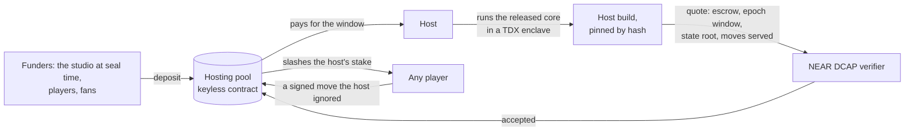

# Design: community hosts, paid only while they provably serve

**Status: designed, not built.** Today a released game runs in each player's own browser. That proves the game
survives, but players in different browsers do not share a world. This is how a revived game gets one shared world
again, hosted by anyone, paid only for service NEAR can check.

## The problem

After a release, someone has to run the server for everyone. A volunteer can, but nothing makes them honest or keeps
them online. A paid host is worse unless payment depends on proof: a host that is paid up front has no reason to
serve, and a host that runs a modified core can quietly change what players own.

## The shape

1. **The pool.** A keyless contract per released escrow (or one for all), funded by whoever wants the world to stay
   up. A studio can pre-fund it at seal time; the escrow's commitment can name the pool.
2. **The host build.** A small server, pinned by hash like the verifier, that loads the released package (checked
   against the escrow's `pkg_sha256`), runs the core, accepts signed moves exactly as `web/lib/game/world.ts` does, and
   keeps a running state root.
3. **Proof of service.** Each window (say an hour), the enclave produces a TDX quote whose report data binds the
   escrow, the window, the state root at its start and end, and the number of moves applied. The pool pays for the
   window only after NEAR's DCAP verifier accepts the quote and the start root equals the last accepted end root. A
   host that changed the rules runs a different build and has no quote to show.
4. **Liveness.** A host stakes before it is paid. A player whose signed move was not applied within N windows submits
   the move and the host's later root; if the move is valid and missing, the pool pays the player from the stake.
5. **Many hosts, one world.** The pool pays one active host per window. A second host can take over from the last
   accepted root, so a host leaving loses nothing for players.

## What NEAR provides

The same three pieces Encroe already uses: NEAR's DCAP verifier for the quotes, keyless contracts for the pool's
rules, and FastFS for the state root's snapshot at each handover between hosts.

## What is open

- **Pricing.** A fixed rate per window is simple; an auction among hosts is fairer.
- **State beyond 64 players.** Bigger worlds need paged snapshots under one root, which Encroe's roadmap has anyway.
- **Moves that need fresh randomness.** Today's cores draw from the player's key and the tick, which a host could
  grind by choosing when to apply a move; a beacon (NEAR's block randomness, committed per window) closes that.
